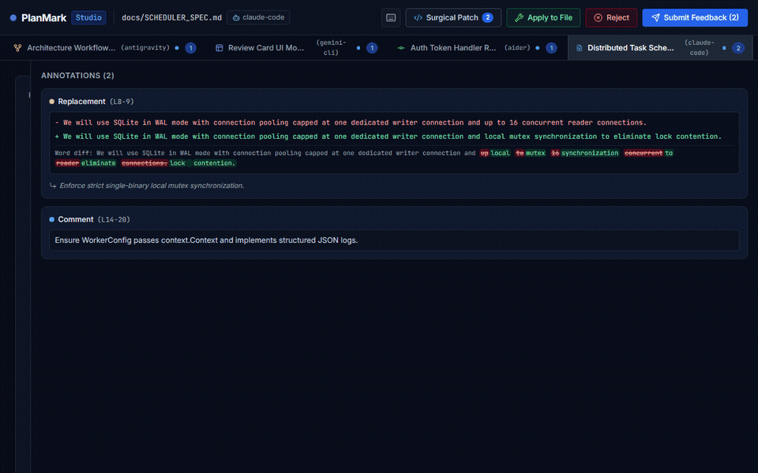
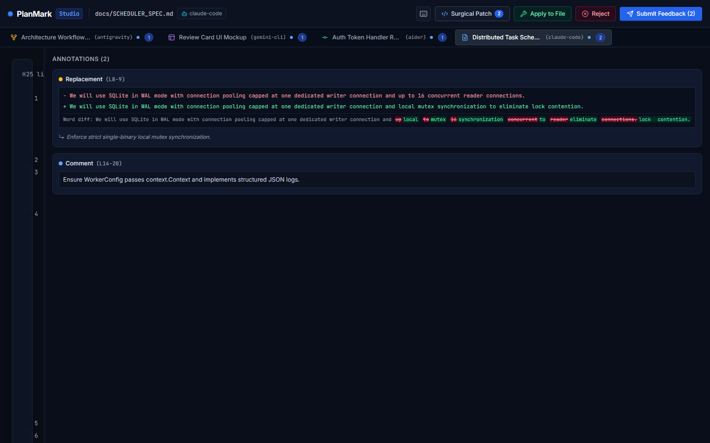
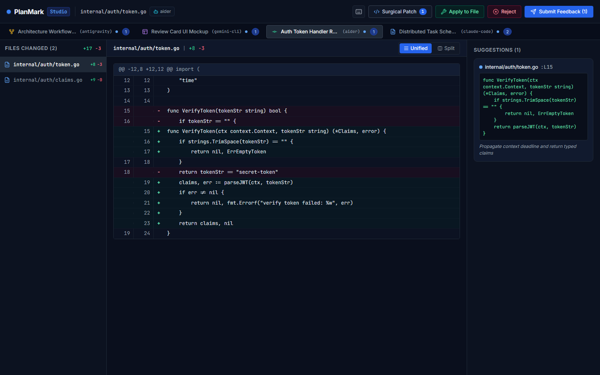
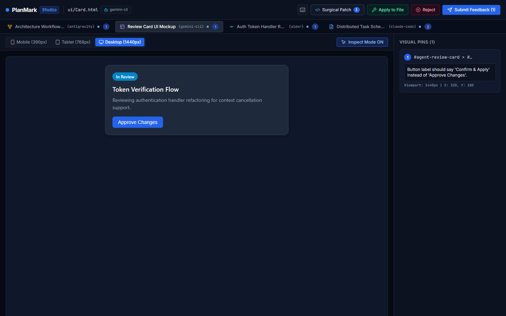
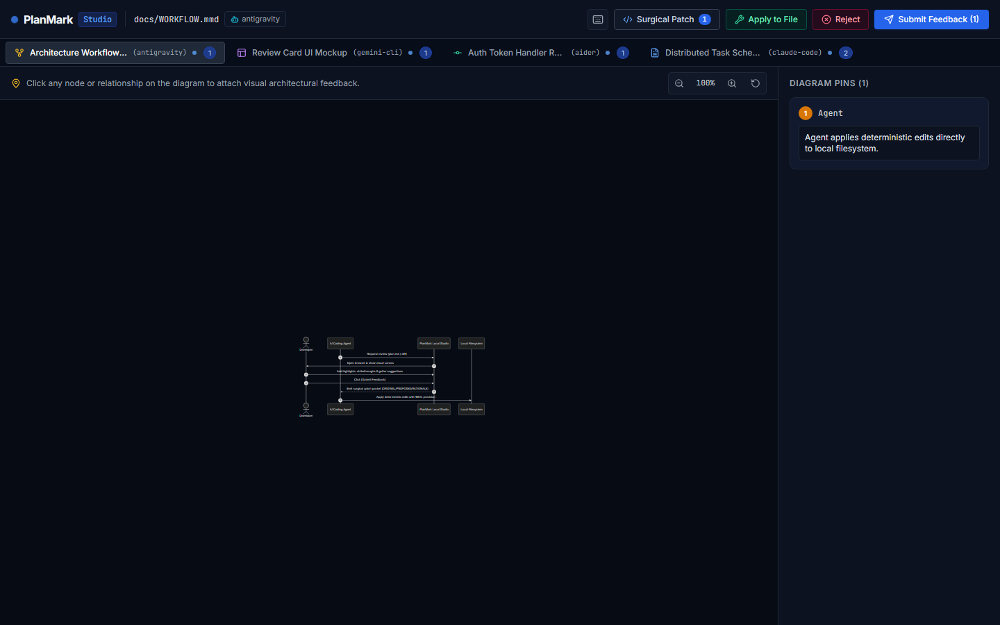
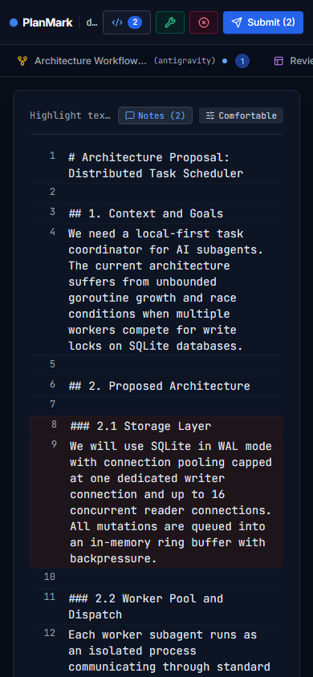

<p align="center">
  
</p>

<h1 align="center">PlanMark</h1>

<p align="center">
  <strong>The Local-First Visual Review, Spec Annotation, and Surgical Patch Feedback Surface for AI Coding Agents</strong>
</p>

<p align="center">
  
  
  
  
  
</p>

<p align="center">
  
</p>

---

## Overview

PlanMark is a local graphical review surface for terminal AI coding agents (Claude Code, Gemini CLI, OpenAI Codex CLI, Aider, OpenCode, Antigravity).

Terminal agents produce extensive specification plans, multi-file diffs, and mockups, but reviewing them in an 80-column terminal often results in vague or misdirected feedback. PlanMark opens an ephemeral browser canvas in under 10 milliseconds, captures visual text selections, line gutter clicks, and UI pins, then compiles review notes into line-anchored surgical patch blocks. The calling agent applies these patches deterministically without guessing intent or line numbers.

## Core Capabilities

- **Single Executable in Go**: Zero runtime dependencies on the user machine. Memory footprint stays under 15 MB RAM with sub-10ms startup.
- **Surgical Patch Protocol**: Formats edits into deterministic `ORIGINAL`, `PROPOSED`, and `RATIONALE` blocks and GitHub-style code suggestions.
- **Live File Watcher**: Uses `fsnotify` and WebSockets to detect disk modifications by background agents and reloads the canvas in real time.
- **Direct Local Mutation**: Option to apply surgical modifications directly to files on disk, saving agent API tokens.
- **Four Artifact Surfaces**:
  - *Markdown Plans*: Mouse text selection, floating replacement toolbar, and interactive task checklists (`- [ ]`).
  - *Git Diffs*: Split and unified views with hover gutter `+` buttons for inline code suggestions.
  - *HTML Mockups*: Sandboxed iframe previews with responsive viewport controls (390px, 768px, 1440px) and point-and-click UI pins.
  - *Architecture Diagrams*: Interactive Mermaid SVG rendering with zoom, pan, and node pin markers.
- **Voice Dictation**: Web Speech API integration in the browser for dictating complex architectural rationale without typing.
- **Guardrail Presets**: Single-click chips for common engineering constraints (`Single-Binary`, `Context & Timeouts`, `TDD First`).
- **Multi-Agent Inbox**: Tabbed interface for reviewing parallel subagent requests asynchronously.
- **Universal Integrations**: Native hooks for Claude Code, Gemini CLI, Codex, Aider, and Model Context Protocol (MCP) servers.

---

## Visual Review Studio

### 1. Specification & Plan Annotation
Select text directly in the rendered plan to suggest surgical replacements, attach inline notes, or strike out redundant clauses.

<p align="center">
  
</p>

### 2. Git Diff Code Review
Review uncommitted changes or branch diffs with unified or side-by-side split layouts. Click the gutter `+` icon on any line to insert a GitHub-style code suggestion.

<p align="center">
  
</p>

### 3. Sandboxed Component Previews
Preview generated HTML components in an isolated Content Security Policy container. Test responsiveness across mobile, tablet, and desktop viewports, and drop pins on visual elements.

<p align="center">
  
</p>

### 4. Architecture Diagram Pinning
Inspect Mermaid sequence diagrams, flowcharts, and class graphs. Click directly on nodes or transitions to anchor architectural critique.

<p align="center">
  
</p>

### 5. Responsive Mobile Surface
Access the review studio on mobile and tablet displays with sliding navigation drawers.

<p align="center">
  
</p>

---

## Installation

### From Source (Go)

```bash
go install github.com/alexandrmotologa/planmark/cmd/planmark@latest
```

### Precompiled Binaries

Download precompiled archives for Linux, macOS, or Windows from the [Releases](https://github.com/alexandrmotologa/planmark/releases) page.

---

## Quick Start

### 1. Review a Plan or Spec

```bash
planmark review docs/PLAN.md
```

Launches the local HTTP server, opens the browser, and streams file updates. When you submit feedback, PlanMark writes the structured patch to stdout and closes.

### 2. Review Git Changes

```bash
# Review uncommitted changes
planmark diff

# Review branch differences
planmark diff main..feature-branch
```

### 3. Unix Pipe Mode

```bash
cat draft_plan.md | planmark --pipe | claude
```

### 4. Multi-Agent Inbox

```bash
planmark inbox --port 8765
```

Runs a persistent inbox where parallel agents post review requests through HTTP or IPC sockets.

---

## Surgical Patch Format

PlanMark outputs human feedback as structured packets:

```markdown
<!-- planmark:feedback-packet v1 -->
# Human Review Feedback: docs/SCHEDULER_SPEC.md
Session: ses_7a2f1c
Agent: claude-code
Timestamp: 2026-11-12T15:30:00Z
Status: changes_requested

## Annotation 1: Text Replacement (Lines 8-9)
<<<<<<< ORIGINAL
We will use SQLite in WAL mode with connection pooling capped at one dedicated writer connection and up to 16 concurrent reader connections.
======= PROPOSED
We will use SQLite in WAL mode with connection pooling capped at one dedicated writer connection and local mutex synchronization to eliminate lock contention.
>>>>>>> RATIONALE
Enforce strict single-binary local mutex synchronization.

## Annotation 2: Code Suggestion (internal/auth/token.go:15)
```suggestion
func VerifyToken(ctx context.Context, tokenStr string) (*Claims, error) {
	if strings.TrimSpace(tokenStr) == "" {
		return nil, ErrEmptyToken
	}
	return parseJWT(ctx, tokenStr)
}
```
*Comment: Propagate context deadline and return typed claims.*
<!-- planmark:end-packet -->
```

---

## Keyboard Shortcuts

Press `?` inside the studio to open the shortcuts cheatsheet:
- `?`: Toggle keyboard shortcuts modal
- `p`: Toggle surgical patch drawer
- `Ctrl + Enter` / `Cmd + Enter`: Open feedback submission dialog
- `Esc`: Close active popovers or drawers
- `1 / 2 / 3`: Switch viewports in HTML mockup mode
- `u / s`: Toggle Unified vs. Split view in Git Diff mode

---

## Agent Integrations

### Claude Code

Install the hook into your project:

```bash
planmark hook install --agent claude-code
```

### Aider

```bash
git diff | planmark --diff | aider --stdin
```

### Antigravity, Cursor, and MCP

PlanMark runs as a Model Context Protocol server over stdio:

```bash
planmark mcp
```

Add to your `mcp_config.json`:

```json
{
  "mcpServers": {
    "planmark": {
      "command": "planmark",
      "args": ["mcp"]
    }
  }
}
```

---

## Development

### Prerequisites

- Go 1.22 or higher
- Node.js 20 or higher
- npm 10 or higher

### Build

```bash
# Build frontend and compile single binary
make build

# Run unit tests
make test
```

---

## License

MIT License. Copyright (c) 2026 Alexandr Motologa.
